# ZENWAY Design & Development Resources Map

A permanent project reference document mapping internal skills, external design references, technology stack layers, and architectural principles to each functional area of the **ZENWAY Campus Mobility Exchange**.

---

## 1. Installed Skills (Local Agent Tools)

These specialized skills are installed within the workspace (`.agents/skills/`) and run locally to govern design quality, token consistency, and anti-slop rules:

| Skill | Local Path | Core Capability & Role in ZENWAY |
| :--- | :--- | :--- |
| **UI UX Pro Max** | `.agents/skills/ui-ux-pro-max/` | Multi-stack design intelligence, searchable UI taxonomies (styles, palettes, typography, UX checklists), WCAG 2.1 AA accessibility rules, and shadcn/Base UI guidelines. |
| **Taste Skill** (`design-taste-frontend`) | `.agents/skills/design-taste-frontend/` | Anti-slop frontend discipline (figma.com/x.ai quality bar), 1440×900 initial viewport balance, equal left/right margins, copy linting, curated photography sets, and headless browser visual audits. |
| **Brand** | `.agents/skills/brand/` | Brand voice governance, messaging frameworks, student trust communication, badge rules, and visual identity consistency across modules. |
| **Design System** | `.agents/skills/design-system/` | Three-layer design token architecture (primitive → semantic → component), CSS custom variable sync, and component specification management. |
| **UI Styling** | `.agents/skills/ui-styling/` | shadcn/ui + Base UI component composition, Tailwind CSS utility styling patterns, dark/light theme consistency, and responsive layouts. |
| **Banner Design** | `.agents/skills/banner-design/` | Editorial and social creative banners, marketing assets, campus announcement cards, and promotional launch visuals. |

---

## 2. External Design Websites & Repositories

Curated external references for UI inspiration, interaction patterns, component implementations, and layout structures:

| Resource | Nature / Type | Focus Area |
| :--- | :--- | :--- |
| **Navbar Gallery** | Design Gallery | Curated navigation patterns, responsive desktop-to-mobile transitions, search integrations, and sticky header behaviors. |
| **Footer Design** | Design Gallery | Multi-tier footers, campus directory maps, legal/trust disclosures, and closing brand impressions. |
| **CTA Gallery** | Design Gallery | High-conversion call-to-action blocks, booking triggers, and student action prompts. |
| **Supahero** | Design Gallery | Modern hero section compositions, typography layouts, and initial viewport presentations. |
| **21st.dev** | Component Library / Repository | Contemporary React and Tailwind UI component implementations and creative layout snippets. |
| **Scrolltide** | Interaction Gallery | Scroll-driven storytelling, sticky panel interactions, and progress visualizers. |
| **Refero** | UX/UI Research Archive | Real-world SaaS and mobile app screen flows (onboarding, search, ride booking, activity histories). |
| **3D Icons** | Asset Library | Open-source 3D graphic elements for hero visuals, transit modes, and student badges. |
| **shadcn/ui** | Component System | Accessible, unstyled primitives and base component architecture built on Base UI / Radix and Tailwind. |
| **UI Verse** | Community UI Repository | Creative micro-elements: animated buttons, status pills, custom loaders, and hover micro-interactions. |
| **Motion** (`motion.dev`) | Animation Library | Production animation engine for React (layout transitions, spring physics, route exits). |
| **Motion Primitives** | Component Library | Pre-composed motion UI elements (smooth accordions, popovers, animated tabs, text reveals). |
| **Design Motion Principles** | Motion Design Guide | Functional choreography standards: 150–250ms feedback, meaningful spatial transitions, and reduced-motion compliance. |
| **Open Design** | Design Repository | Open-source design assets, interface templates, and shared design system artifacts. |
| **Awesome Claude Design** | Curated Repository | Hand-picked design inspirations, guidelines, prompt collections, and modern design best practices. |

---

## 3. Resource Mapping to ZENWAY Development Areas

Every ZENWAY module has specific designated skills and external references:

```mermaid
flowchart TD
    subgraph CorePlatform ["ZENWAY Platform Areas"]
        Brand["Brand Identity & Visual Direction"]
        Nav["Header & Global Navigation"]
        Hero["Hero & Landing Presentation"]
        Rent["RENT: Vehicle & Scooter Hubs"]
        Ride["RIDE: Student Carpooling"]
        Carry["CARRY: Peer Package Transport"]
        StudentDash["Student Activity Dashboard"]
        AdminDash["Admin & Safety Verification"]
        FooterArea["Closing Footer & Legal"]
        MotionArea["Animations & Interactions"]
    end

    subgraph Skills ["Installed Skills"]
        S_Brand["Brand Skill"]
        S_Taste["Taste Skill"]
        S_ProMax["UI UX Pro Max"]
        S_Styling["UI Styling"]
        S_DesignSys["Design System"]
        S_Banner["Banner Design"]
    end

    Brand --- S_Brand
    Brand --- S_DesignSys
    Nav --- S_Taste
    Nav --- S_Styling
    Hero --- S_Taste
    Hero --- S_Banner
    Rent --- S_ProMax
    Ride --- S_ProMax
    Carry --- S_ProMax
    StudentDash --- S_ProMax
    AdminDash --- S_ProMax
    FooterArea --- S_Taste
    MotionArea --- S_Taste
```

### Detailed Area Mapping

| ZENWAY Development Area | Primary Installed Skills | Primary External Design References | Key Focus & Implementation Objective |
| :--- | :--- | :--- | :--- |
| **1. Brand Identity** | Brand, Design System | Open Design, Awesome Claude Design | Distinct student mobility personality: Trustworthy, Youthful, Safe, Professional. OKLCH tokens and Geist typography. |
| **2. Header & Navigation** | Taste Skill, UI Styling | Navbar Gallery, shadcn/ui | Sticky glass header, tactile mobile bottom bar (48px targets), verified student badge, live transit alerts. |
| **3. Hero & Landing Page** | Taste Skill, Banner Design | Supahero, 21st.dev, CTA Gallery | Strict 1440×900 initial viewport balance, equal gutters, clear value statement, quick-booking trigger, zero cut-off awkwardness. |
| **4. RENT (Vehicle Listings)** | UI UX Pro Max, UI Styling | Refero, 21st.dev, shadcn/ui | Student vehicle and e-bike listings, battery/fuel status, pricing transparency, deposit safety terms, pickup hubs. |
| **5. RIDE (Carpool & Rides)** | UI UX Pro Max, Design System | Refero, UI Verse | Origin/destination route matchers, seat inventory, driver safety rating, departure time telemetry (`font-mono`). |
| **6. CARRY (Peer Delivery)** | UI UX Pro Max, UI Styling | Refero, 3D Icons | Small package & textbook delivery requests, campus zone drops, courier verification, delivery progress steps. |
| **7. Student Dashboard** | UI UX Pro Max, UI Styling | Refero, shadcn/ui | Active bookings, carpool ride tracking, rental timers, saved campus routes, notification preferences. |
| **8. Admin Dashboard** | UI UX Pro Max, Design System | shadcn/ui | Campus domain verification queue, fleet telemetry, student safety report escalations, audit logs. |
| **9. Footer** | Taste Skill, Brand | Footer Design | Single-screen closing section, student safety helpline, emergency campus police link, licence credits, terms. |
| **10. Animations & Interactions** | Taste Skill, UI UX Pro Max | Motion, Motion Primitives, Design Motion Principles | Purposeful micro-interactions: 2px card hover lifts, 150–250ms state changes, spring active presses, `prefers-reduced-motion` compliance. |

---

## 4. Engineering & Technology Stack

The engineering stack is optimized for high-performance static rendering, reactive client state, and real-time backend extensions:

- **Frontend Framework**: React 19 + TypeScript (strict typing enabled).
- **Build Tooling & Bundler**: Vite with `@vitejs/plugin-react` and `@tailwindcss/vite`.
- **CSS & Design Engine**: Tailwind CSS v4 (inline theme directives, OKLCH color space, `@fontsource-variable/geist`).
- **Component Architecture**: shadcn/ui built on `@base-ui/react` (Base UI primitives) with `class-variance-authority`.
- **Icons**: Lucide React (`lucide-react`).
- **Motion & Physics**: `motion` (`motion/react`) for layout and enter transitions.
- **Backend & Database**: Supabase (PostgreSQL, Row Level Security, Auth, Realtime channels).
- **Hosting & Edge Delivery**: Cloudflare Pages (global edge distribution, fast TTFB).
- **Email & Communications**: Resend (transactional booking receipts, verification emails).
- **Maps & Geolocation**: OpenStreetMap data with Leaflet (campus shuttle paths, hub pins, walking boundaries).

---

## 5. Permanent Development Principles

These eight principles govern all engineering and design decisions in ZENWAY:

1. **Reuse Existing High-Quality Implementations**:
   - Leverage verified shadcn/Base UI primitives and established accessible patterns rather than reinventing standard components from scratch.
2. **Inspect Before Implementing**:
   - Check existing code, props, and design system tokens in `src/index.css` before writing new classes or modules.
3. **Avoid Duplicate Dependencies**:
   - Check `package.json` before adding packages. Utilize existing installed packages (`motion`, `@base-ui/react`, `lucide-react`, `next-themes`).
4. **Use Installed Skills Deliberately**:
   - Consult `ui-ux-pro-max` for accessibility, color science, and component patterns; use `design-taste-frontend` for layout boundaries, anti-slop copy, and visual balance.
5. **Focus Custom Engineering on Actual ZENWAY Functionality**:
   - Reserve custom engineering for unique campus mobility logic: RENT hub checks, RIDE seat matching, CARRY chain custody, and university domain security.
6. **Build & Test Complete User Journeys Feature by Feature**:
   - Develop one complete end-to-end slice at a time, ensuring validation and responsiveness before progressing.
7. **Never Mistake a Successful Build for Good Design**:
   - TypeScript compilation and zero build errors do not guarantee visual polish, typographic rhythm, or intuitive UX. Review layouts visually in both light and dark themes.
8. **Do Not Invent Live or Backend-Dependent Functionality**:
   - When building UI before backend integration, clearly indicate demonstration states and mock data without simulating fake persistent security checks.

---

## 6. Approved Visual Direction

- **Theme & Aesthetic**: Premium Mobility with subtle Urban Technology elements.
- **Tone**: Clean, youthful, trustworthy, and calm ("Zen").
- **Core Color Identity (OKLCH)**:
  - **Zenith Blue** (`oklch(0.48 0.22 260)` / Dark `oklch(0.62 0.20 255)`): Authoritative campus anchor and primary branding.
  - **Pulse Tangerine** (`oklch(0.62 0.21 42)` / Dark `oklch(0.72 0.18 50)`): High-priority mobility action triggers, booking CTAs, and active alerts.
  - **Safety Emerald** (`oklch(0.60 0.17 155)` / Dark `oklch(0.75 0.16 155)`): Student verification badges, safe arrival indicators, and on-time statuses.
- **Typography**: `Geist Variable` for high-clarity Swiss UI hierarchy; monospace (`font-mono`) for transit telemetry, route numbers, license plates, and timestamps.
- **Geometry**: `0.75rem` (12px) base radius for approachable modern geometry without childlike exaggeration.
