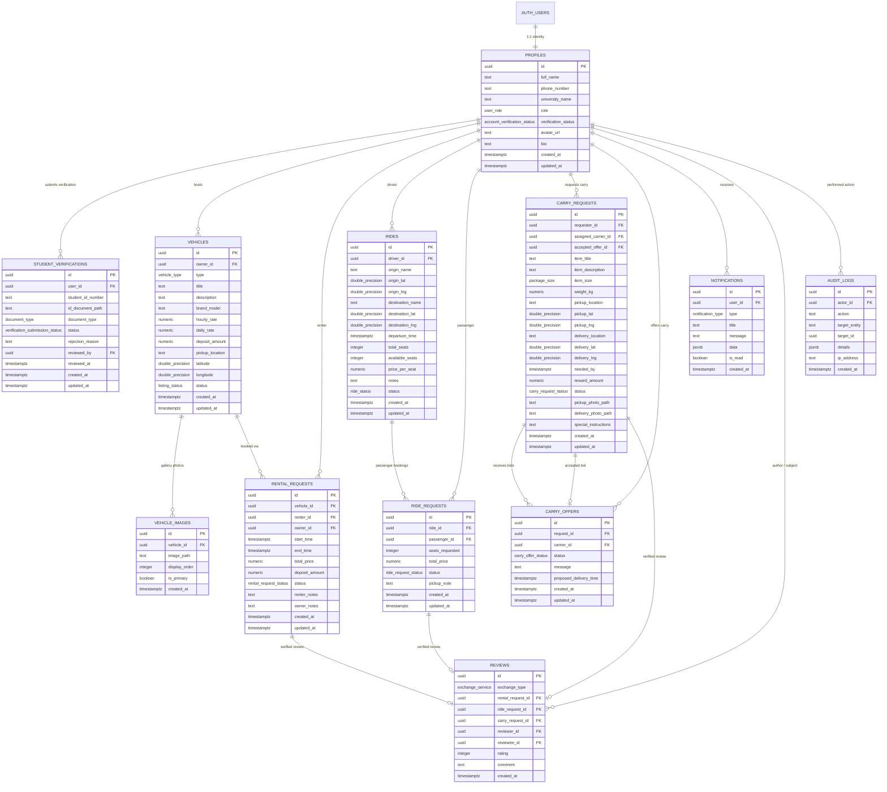
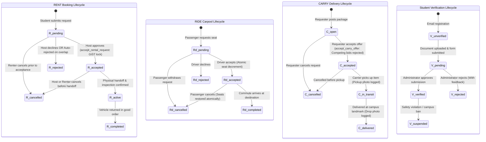

# ZENWAY — Master Database Architecture & Security Specification
**Platform:** PostgreSQL 15+ (Supabase)  
**Document Version:** 3.0.0 (Production Hardened Master Blueprint)  
**Status:** Approved Technical Architecture & Implementation Blueprint  
**Author:** Antigravity Data Architecture & Security Engineering Team  
**Last Updated:** November 2026  

---

## 1. Executive Summary & Foundational Decisions

ZENWAY is a peer-to-peer campus mobility exchange designed exclusively for verified university students. The platform unifies three mobility modalities:
1. **RENT:** Micro-mobility peer rentals (bicycles, e-scooters, skateboards, motorbikes, cars).
2. **RIDE:** Peer carpooling, scheduled rides, and shared inter-campus travel.
3. **CARRY:** Peer parcel, textbook, and package transit across university campuses.

### Foundational Product, Security & Architectural Decisions

* **Authentication & Identity:** User authentication is managed via Supabase Auth (`auth.users`) accepting standard personal email addresses (`@gmail.com`, `@outlook.com`, etc.).
* **Student Verification Pipeline:** A two-stage access model. Any authenticated user creates an initial profile in `unverified` standing. To participate in listings, requests, rides, or carries, students must upload enrollment credentials (student ID card, enrollment certificate) into the private `student-ids` storage bucket. Approvals are strictly moderated by campus administrators.
* **Financial Model:** Peer-to-peer settlement (cash or direct UPI) conducted directly between peers upon physical handoff. There is no integrated payment gateway, card vault, or on-platform financial custody in Phase 1.
* **Location & Telemetry:** No persistent background GPS tracking. Locations are stored as landmark strings accompanied by optional standard coordinates (`double precision` latitude and longitude) for static campus map pins.
* **Storage Privacy:**
  * **Private Buckets:** `student-ids` and `carry-photos` (handoff proof) are private. Access is mediated via Postgres RLS on `storage.objects` and time-limited signed URLs.
  * **Public Buckets:** `vehicle-images` and `avatars` are public for platform browsing.
* **Concurrency & Integrity Guarantees:**
  * Overlapping vehicle bookings are physically prevented at the storage engine level using a PostgreSQL GiST exclusion constraint with temporal ranges (`tstzrange`).
  * Ride seat allocations are serialized and protected from over-allocation using row-level locking (`FOR UPDATE`) and CHECK constraints.
  * Carry offer acceptances are atomic, single-winner transactions that auto-reject competing bids.
* **No Review Expiry:** Reviews remain unconstrained by arbitrary expiration countdowns, permitted anytime following confirmed exchange completion (`status = 'completed'`).
* **Optional Carry Weight:** Package weight remains an optional numeric hint (`weight_kg`) with no hard database ceiling, relying on category dimensions.

---

## 2. Complete Entity Relationship Architecture



---

## 3. Enumerated Types (Exact Enums: 14 Total)

All enum definitions are strictly partitioned between administrative authorization, verification standing, module domains, and event classifications:

```sql
-- 1. Authorization tier
CREATE TYPE user_role AS ENUM ('student', 'admin');

-- 2. Account-level access standing (stored on profiles)
CREATE TYPE account_verification_status AS ENUM ('unverified', 'pending', 'verified', 'suspended');

-- 3. Individual document review state (stored on student_verifications)
CREATE TYPE verification_submission_status AS ENUM ('pending', 'approved', 'rejected');

-- 4. Acceptable university proof documents
CREATE TYPE document_type AS ENUM (
    'student_id_card',
    'enrollment_certificate',
    'tuition_receipt',
    'campus_portal_screenshot'
);

-- 5. Vehicle categories for RENT
CREATE TYPE vehicle_type AS ENUM ('bicycle', 'e_scooter', 'car', 'motorcycle');

-- 6. Vehicle listing discovery state
CREATE TYPE listing_status AS ENUM ('available', 'paused', 'archived');

-- 7. Rental booking transaction lifecycle
CREATE TYPE rental_request_status AS ENUM (
    'pending',
    'accepted',
    'rejected',
    'active',
    'completed',
    'cancelled'
);

-- 8. Carpool ride lifecycle
CREATE TYPE ride_status AS ENUM ('scheduled', 'in_progress', 'completed', 'cancelled');

-- 9. Passenger seat request state
CREATE TYPE ride_request_status AS ENUM ('pending', 'accepted', 'rejected', 'cancelled');

-- 10. Item volume classification for CARRY
CREATE TYPE package_size AS ENUM ('envelope', 'small_box', 'backpack', 'medium_box');

-- 11. Package delivery request lifecycle
CREATE TYPE carry_request_status AS ENUM (
    'open',
    'accepted',
    'in_transit',
    'delivered',
    'cancelled'
);

-- 12. Carrier bid state
CREATE TYPE carry_offer_status AS ENUM ('pending', 'accepted', 'rejected', 'cancelled');

-- 13. Service category for verified peer reviews
CREATE TYPE exchange_service AS ENUM ('rent', 'ride', 'carry');

-- 14. Event classifications for in-app notifications
CREATE TYPE notification_type AS ENUM (
    'rental_request_received',
    'rental_request_accepted',
    'rental_request_rejected',
    'rental_active',
    'rental_completed',
    'ride_request_received',
    'ride_request_accepted',
    'ride_request_rejected',
    'ride_cancelled',
    'carry_offer_received',
    'carry_offer_accepted',
    'carry_in_transit',
    'carry_delivered',
    'verification_submitted',
    'verification_approved',
    'verification_rejected',
    'review_received',
    'system_announcement'
);
```

---

## 4. Comprehensive Table Specifications

### 4.1. Table: `profiles`
* **Purpose:** Core identity profile synchronised 1:1 with `auth.users`.
* **Privacy Controls:** Excludes email (kept in `auth.users`) and student ID numbers (kept in `student_verifications`). Phone numbers are strictly shielded from unassociated users through selective RLS policies and the `public_profiles` secure view.
* **Primary Key:** `id` (`uuid`), references `auth.users(id) ON DELETE CASCADE`.

```sql
CREATE TABLE profiles (
    id uuid PRIMARY KEY REFERENCES auth.users(id) ON DELETE CASCADE,
    full_name text NOT NULL CHECK (length(trim(full_name)) >= 2),
    phone_number text NULL,
    university_name text NULL,
    role user_role NOT NULL DEFAULT 'student',
    verification_status account_verification_status NOT NULL DEFAULT 'unverified',
    avatar_url text NULL,
    bio text NULL CHECK (bio IS NULL OR length(bio) <= 500),
    created_at timestamptz NOT NULL DEFAULT now(),
    updated_at timestamptz NOT NULL DEFAULT now()
);

CREATE INDEX idx_profiles_verification_status ON profiles(verification_status);
CREATE INDEX idx_profiles_role ON profiles(role);
```

---

### 4.2. Table: `student_verifications`
* **Purpose:** Stores sensitive student ID cards, enrollment proofs, and administrative audit trails.
* **Primary Key:** `id` (`uuid`), default `gen_random_uuid()`.

```sql
CREATE TABLE student_verifications (
    id uuid PRIMARY KEY DEFAULT gen_random_uuid(),
    user_id uuid NOT NULL REFERENCES profiles(id) ON DELETE CASCADE,
    student_id_number text NOT NULL CHECK (length(trim(student_id_number)) >= 3),
    id_document_path text NOT NULL,
    document_type document_type NOT NULL DEFAULT 'student_id_card',
    status verification_submission_status NOT NULL DEFAULT 'pending',
    rejection_reason text NULL,
    reviewed_by uuid NULL REFERENCES profiles(id) ON DELETE SET NULL,
    reviewed_at timestamptz NULL,
    created_at timestamptz NOT NULL DEFAULT now(),
    updated_at timestamptz NOT NULL DEFAULT now()
);

-- Integrity: A student can only have one active 'pending' review at a time
CREATE UNIQUE INDEX idx_single_pending_verification 
    ON student_verifications(user_id) 
    WHERE status = 'pending';

CREATE INDEX idx_verifications_queue ON student_verifications(status, created_at ASC);
```

---

### 4.3. Table: `vehicles`
* **Purpose:** Host vehicle inventory for peer rental in RENT.
* **Primary Key:** `id` (`uuid`), default `gen_random_uuid()`.

```sql
CREATE TABLE vehicles (
    id uuid PRIMARY KEY DEFAULT gen_random_uuid(),
    owner_id uuid NOT NULL REFERENCES profiles(id) ON DELETE RESTRICT,
    type vehicle_type NOT NULL,
    title text NOT NULL CHECK (length(trim(title)) >= 4),
    description text NOT NULL CHECK (length(trim(description)) >= 10),
    brand_model text NULL,
    hourly_rate numeric(10,2) NULL CHECK (hourly_rate IS NULL OR hourly_rate > 0),
    daily_rate numeric(10,2) NULL CHECK (daily_rate IS NULL OR daily_rate > 0),
    deposit_amount numeric(10,2) NOT NULL DEFAULT 0.00 CHECK (deposit_amount >= 0),
    pickup_location text NOT NULL,
    latitude double precision NULL CHECK (latitude IS NULL OR (latitude >= -90 AND latitude <= 90)),
    longitude double precision NULL CHECK (longitude IS NULL OR (longitude >= -180 AND longitude <= 180)),
    status listing_status NOT NULL DEFAULT 'available',
    created_at timestamptz NOT NULL DEFAULT now(),
    updated_at timestamptz NOT NULL DEFAULT now(),
    CONSTRAINT chk_vehicle_has_rate CHECK (hourly_rate IS NOT NULL OR daily_rate IS NOT NULL)
);

CREATE INDEX idx_vehicles_owner ON vehicles(owner_id);
CREATE INDEX idx_vehicles_browse ON vehicles(type, status) WHERE status = 'available';
```

---

### 4.4. Table: `vehicle_images`
* **Purpose:** Gallery photos stored in public bucket `vehicle-images`.
* **Primary Key:** `id` (`uuid`), default `gen_random_uuid()`.

```sql
CREATE TABLE vehicle_images (
    id uuid PRIMARY KEY DEFAULT gen_random_uuid(),
    vehicle_id uuid NOT NULL REFERENCES vehicles(id) ON DELETE CASCADE,
    image_path text NOT NULL,
    display_order integer NOT NULL DEFAULT 0 CHECK (display_order >= 0),
    is_primary boolean NOT NULL DEFAULT false,
    created_at timestamptz NOT NULL DEFAULT now()
);

CREATE UNIQUE INDEX idx_single_primary_vehicle_image 
    ON vehicle_images(vehicle_id) 
    WHERE is_primary = true;

CREATE INDEX idx_vehicle_images_lookup ON vehicle_images(vehicle_id, display_order ASC);
```

---

### 4.5. Table: `rental_requests`
* **Purpose:** Booking transactions and schedule reservations for vehicle rentals.
* **Primary Key:** `id` (`uuid`), default `gen_random_uuid()`.

```sql
CREATE TABLE rental_requests (
    id uuid PRIMARY KEY DEFAULT gen_random_uuid(),
    vehicle_id uuid NOT NULL REFERENCES vehicles(id) ON DELETE RESTRICT,
    renter_id uuid NOT NULL REFERENCES profiles(id) ON DELETE RESTRICT,
    owner_id uuid NOT NULL REFERENCES profiles(id) ON DELETE RESTRICT,
    start_time timestamptz NOT NULL,
    end_time timestamptz NOT NULL,
    total_price numeric(10,2) NOT NULL CHECK (total_price >= 0),
    deposit_amount numeric(10,2) NOT NULL DEFAULT 0.00 CHECK (deposit_amount >= 0),
    status rental_request_status NOT NULL DEFAULT 'pending',
    renter_notes text NULL,
    owner_notes text NULL,
    created_at timestamptz NOT NULL DEFAULT now(),
    updated_at timestamptz NOT NULL DEFAULT now(),
    CONSTRAINT chk_rental_dates CHECK (end_time > start_time),
    CONSTRAINT chk_rental_not_self CHECK (renter_id != owner_id)
);

-- Hard Engine-level Concurrency Guard: GiST exclusion constraint preventing double bookings
ALTER TABLE rental_requests
ADD CONSTRAINT no_overlapping_accepted_rentals
EXCLUDE USING gist (
    vehicle_id WITH =,
    tstzrange(start_time, end_time, '[)') WITH &&
) WHERE (status IN ('accepted', 'active'));

CREATE INDEX idx_rental_requests_renter ON rental_requests(renter_id, status);
CREATE INDEX idx_rental_requests_owner ON rental_requests(owner_id, status);
CREATE INDEX idx_rental_requests_vehicle ON rental_requests(vehicle_id, status);
```

---

### 4.6. Table: `rides`
* **Purpose:** Campus carpool listings published by verified drivers.
* **Primary Key:** `id` (`uuid`), default `gen_random_uuid()`.

```sql
CREATE TABLE rides (
    id uuid PRIMARY KEY DEFAULT gen_random_uuid(),
    driver_id uuid NOT NULL REFERENCES profiles(id) ON DELETE RESTRICT,
    origin_name text NOT NULL,
    origin_lat double precision NULL CHECK (origin_lat IS NULL OR (origin_lat >= -90 AND origin_lat <= 90)),
    origin_lng double precision NULL CHECK (origin_lng IS NULL OR (origin_lng >= -180 AND origin_lng <= 180)),
    destination_name text NOT NULL,
    destination_lat double precision NULL CHECK (destination_lat IS NULL OR (destination_lat >= -90 AND destination_lat <= 90)),
    destination_lng double precision NULL CHECK (destination_lng IS NULL OR (destination_lng >= -180 AND destination_lng <= 180)),
    departure_time timestamptz NOT NULL,
    total_seats integer NOT NULL CHECK (total_seats BETWEEN 1 AND 8),
    available_seats integer NOT NULL CHECK (available_seats >= 0),
    price_per_seat numeric(10,2) NOT NULL DEFAULT 0.00 CHECK (price_per_seat >= 0),
    notes text NULL CHECK (notes IS NULL OR length(notes) <= 500),
    status ride_status NOT NULL DEFAULT 'scheduled',
    created_at timestamptz NOT NULL DEFAULT now(),
    updated_at timestamptz NOT NULL DEFAULT now(),
    CONSTRAINT chk_seats_available_lte_total CHECK (available_seats <= total_seats)
);

CREATE INDEX idx_rides_driver ON rides(driver_id);
CREATE INDEX idx_rides_feed ON rides(departure_time ASC, status) WHERE status = 'scheduled';
```

---

### 4.7. Table: `ride_requests`
* **Purpose:** Passenger seat bookings and confirmations for carpools.
* **Referential Integrity:** Set to `ON DELETE RESTRICT` for both `ride_id` and `passenger_id` to strictly preserve booking history and dispute records.
* **Primary Key:** `id` (`uuid`), default `gen_random_uuid()`.

```sql
CREATE TABLE ride_requests (
    id uuid PRIMARY KEY DEFAULT gen_random_uuid(),
    ride_id uuid NOT NULL REFERENCES rides(id) ON DELETE RESTRICT,
    passenger_id uuid NOT NULL REFERENCES profiles(id) ON DELETE RESTRICT,
    seats_requested integer NOT NULL DEFAULT 1 CHECK (seats_requested BETWEEN 1 AND 4),
    total_price numeric(10,2) NOT NULL DEFAULT 0.00 CHECK (total_price >= 0),
    status ride_request_status NOT NULL DEFAULT 'pending',
    pickup_note text NULL,
    created_at timestamptz NOT NULL DEFAULT now(),
    updated_at timestamptz NOT NULL DEFAULT now()
);

-- Integrity: Prevent duplicate active seat applications for the same ride
CREATE UNIQUE INDEX idx_unique_active_passenger_ride_request 
    ON ride_requests(ride_id, passenger_id) 
    WHERE status IN ('pending', 'accepted');

CREATE INDEX idx_ride_requests_passenger ON ride_requests(passenger_id, status);
CREATE INDEX idx_ride_requests_ride ON ride_requests(ride_id, status);
```

---

### 4.8. Table: `carry_requests`
* **Purpose:** Item courier and peer package transport requests across campus.
* **Primary Key:** `id` (`uuid`), default `gen_random_uuid()`.

```sql
CREATE TABLE carry_requests (
    id uuid PRIMARY KEY DEFAULT gen_random_uuid(),
    requester_id uuid NOT NULL REFERENCES profiles(id) ON DELETE RESTRICT,
    assigned_carrier_id uuid NULL REFERENCES profiles(id) ON DELETE RESTRICT,
    accepted_offer_id uuid NULL, -- Foreign key added below after carry_offers table creation
    item_title text NOT NULL CHECK (length(trim(item_title)) >= 3),
    item_description text NOT NULL,
    item_size package_size NOT NULL DEFAULT 'small_box',
    weight_kg numeric(5,2) NULL CHECK (weight_kg IS NULL OR weight_kg > 0),
    pickup_location text NOT NULL,
    pickup_lat double precision NULL CHECK (pickup_lat IS NULL OR (pickup_lat >= -90 AND pickup_lat <= 90)),
    pickup_lng double precision NULL CHECK (pickup_lng IS NULL OR (pickup_lng >= -180 AND pickup_lng <= 180)),
    delivery_location text NOT NULL,
    delivery_lat double precision NULL CHECK (delivery_lat IS NULL OR (delivery_lat >= -90 AND delivery_lat <= 90)),
    delivery_lng double precision NULL CHECK (delivery_lng IS NULL OR (delivery_lng >= -180 AND delivery_lng <= 180)),
    needed_by timestamptz NOT NULL,
    reward_amount numeric(10,2) NOT NULL DEFAULT 0.00 CHECK (reward_amount >= 0),
    status carry_request_status NOT NULL DEFAULT 'open',
    pickup_photo_path text NULL,
    delivery_photo_path text NULL,
    special_instructions text NULL,
    created_at timestamptz NOT NULL DEFAULT now(),
    updated_at timestamptz NOT NULL DEFAULT now(),
    CONSTRAINT chk_carry_carrier_not_requester CHECK (assigned_carrier_id IS NULL OR assigned_carrier_id != requester_id)
);

CREATE INDEX idx_carry_requests_requester ON carry_requests(requester_id, status);
CREATE INDEX idx_carry_requests_carrier ON carry_requests(assigned_carrier_id, status);
CREATE INDEX idx_carry_requests_open ON carry_requests(needed_by ASC, status) WHERE status = 'open';
```

---

### 4.9. Table: `carry_offers`
* **Purpose:** Student carrier route offers to transport open packages.
* **Primary Key:** `id` (`uuid`), default `gen_random_uuid()`.

```sql
CREATE TABLE carry_offers (
    id uuid PRIMARY KEY DEFAULT gen_random_uuid(),
    request_id uuid NOT NULL REFERENCES carry_requests(id) ON DELETE CASCADE,
    carrier_id uuid NOT NULL REFERENCES profiles(id) ON DELETE RESTRICT,
    status carry_offer_status NOT NULL DEFAULT 'pending',
    message text NULL,
    proposed_delivery_time timestamptz NULL,
    created_at timestamptz NOT NULL DEFAULT now(),
    updated_at timestamptz NOT NULL DEFAULT now()
);

-- Link carry_requests.accepted_offer_id circular relationship safely
ALTER TABLE carry_requests 
ADD CONSTRAINT fk_carry_accepted_offer 
FOREIGN KEY (accepted_offer_id) REFERENCES carry_offers(id) ON DELETE SET NULL;

-- Integrity: A carrier can only have one pending offer per carry request
CREATE UNIQUE INDEX idx_single_pending_carry_offer 
    ON carry_offers(request_id, carrier_id) 
    WHERE status = 'pending';

CREATE INDEX idx_carry_offers_request ON carry_offers(request_id, status);
CREATE INDEX idx_carry_offers_carrier ON carry_offers(carrier_id, status);
```

---

### 4.10. Table: `reviews`
* **Purpose:** Verified peer reviews following completed exchanges. Uses discrete foreign keys and check constraints to guarantee complete referential integrity.
* **Primary Key:** `id` (`uuid`), default `gen_random_uuid()`.

```sql
CREATE TABLE reviews (
    id uuid PRIMARY KEY DEFAULT gen_random_uuid(),
    exchange_type exchange_service NOT NULL,
    rental_request_id uuid NULL REFERENCES rental_requests(id) ON DELETE CASCADE,
    ride_request_id uuid NULL REFERENCES ride_requests(id) ON DELETE CASCADE,
    carry_request_id uuid NULL REFERENCES carry_requests(id) ON DELETE CASCADE,
    reviewer_id uuid NOT NULL REFERENCES profiles(id) ON DELETE RESTRICT,
    reviewee_id uuid NOT NULL REFERENCES profiles(id) ON DELETE RESTRICT,
    rating integer NOT NULL CHECK (rating BETWEEN 1 AND 5),
    comment text NULL CHECK (comment IS NULL OR length(comment) <= 1000),
    created_at timestamptz NOT NULL DEFAULT now(),
    CONSTRAINT chk_review_not_self CHECK (reviewer_id != reviewee_id),
    CONSTRAINT chk_review_single_fk CHECK (
        (exchange_type = 'rent'  AND rental_request_id IS NOT NULL AND ride_request_id IS NULL AND carry_request_id IS NULL) OR
        (exchange_type = 'ride'  AND ride_request_id IS NOT NULL AND rental_request_id IS NULL AND carry_request_id IS NULL) OR
        (exchange_type = 'carry' AND carry_request_id IS NOT NULL AND rental_request_id IS NULL AND ride_request_id IS NULL)
    )
);

-- Integrity: Exactly one review per author per booking
CREATE UNIQUE INDEX idx_unique_rental_review 
    ON reviews(rental_request_id, reviewer_id) 
    WHERE rental_request_id IS NOT NULL;

CREATE UNIQUE INDEX idx_unique_ride_review 
    ON reviews(ride_request_id, reviewer_id) 
    WHERE ride_request_id IS NOT NULL;

CREATE UNIQUE INDEX idx_unique_carry_review 
    ON reviews(carry_request_id, reviewer_id) 
    WHERE carry_request_id IS NOT NULL;

CREATE INDEX idx_reviews_reviewee ON reviews(reviewee_id);
```

---

### 4.11. Table: `notifications`
* **Purpose:** User alerts, status changes, and deep-link navigation payloads.
* **Primary Key:** `id` (`uuid`), default `gen_random_uuid()`.

```sql
CREATE TABLE notifications (
    id uuid PRIMARY KEY DEFAULT gen_random_uuid(),
    user_id uuid NOT NULL REFERENCES profiles(id) ON DELETE CASCADE,
    type notification_type NOT NULL,
    title text NOT NULL,
    message text NOT NULL,
    data jsonb NOT NULL DEFAULT '{}'::jsonb,
    is_read boolean NOT NULL DEFAULT false,
    created_at timestamptz NOT NULL DEFAULT now()
);

CREATE INDEX idx_notifications_user_unread 
    ON notifications(user_id, created_at DESC) 
    WHERE is_read = false;

CREATE INDEX idx_notifications_user_all 
    ON notifications(user_id, created_at DESC);
```

---

### 4.12. Table: `audit_logs`
* **Purpose:** Tamper-evident log of administrative approvals, rejections, suspensions, and system actions.
* **Primary Key:** `id` (`uuid`), default `gen_random_uuid()`.

```sql
CREATE TABLE audit_logs (
    id uuid PRIMARY KEY DEFAULT gen_random_uuid(),
    actor_id uuid NULL REFERENCES profiles(id) ON DELETE SET NULL,
    action text NOT NULL,
    target_entity text NOT NULL,
    target_id uuid NOT NULL,
    details jsonb NOT NULL DEFAULT '{}'::jsonb,
    ip_address text NULL,
    created_at timestamptz NOT NULL DEFAULT now()
);

CREATE INDEX idx_audit_logs_actor ON audit_logs(actor_id);
CREATE INDEX idx_audit_logs_target ON audit_logs(target_entity, target_id);
CREATE INDEX idx_audit_logs_created_at ON audit_logs(created_at DESC);
```

---

## 5. Request Status Lifecycle State Machines



---

## 6. Complete Database Functions & Trigger Definitions

All functions are written in complete, executable PL/pgSQL with hardened `search_path`, strict input validation, row-level locks, and granular execution privileges.

### 6.1. Generic Helper: Automatic `updated_at` Trigger

```sql
CREATE OR REPLACE FUNCTION set_updated_at()
RETURNS trigger AS $$
BEGIN
    NEW.updated_at = now();
    RETURN NEW;
END;
$$ LANGUAGE plpgsql SECURITY DEFINER SET search_path = public, pg_temp;

-- Attach to all tables with updated_at
CREATE TRIGGER trg_profiles_updated_at BEFORE UPDATE ON profiles FOR EACH ROW EXECUTE FUNCTION set_updated_at();
CREATE TRIGGER trg_student_verifications_updated_at BEFORE UPDATE ON student_verifications FOR EACH ROW EXECUTE FUNCTION set_updated_at();
CREATE TRIGGER trg_vehicles_updated_at BEFORE UPDATE ON vehicles FOR EACH ROW EXECUTE FUNCTION set_updated_at();
CREATE TRIGGER trg_rental_requests_updated_at BEFORE UPDATE ON rental_requests FOR EACH ROW EXECUTE FUNCTION set_updated_at();
CREATE TRIGGER trg_rides_updated_at BEFORE UPDATE ON rides FOR EACH ROW EXECUTE FUNCTION set_updated_at();
CREATE TRIGGER trg_ride_requests_updated_at BEFORE UPDATE ON ride_requests FOR EACH ROW EXECUTE FUNCTION set_updated_at();
CREATE TRIGGER trg_carry_requests_updated_at BEFORE UPDATE ON carry_requests FOR EACH ROW EXECUTE FUNCTION set_updated_at();
CREATE TRIGGER trg_carry_offers_updated_at BEFORE UPDATE ON carry_offers FOR EACH ROW EXECUTE FUNCTION set_updated_at();
```

---

### 6.2. Authorization Helpers: `is_admin()` and `is_verified_student()`

These functions read directly from the cached profile row, bypassing recursive RLS checks:

```sql
CREATE OR REPLACE FUNCTION is_admin()
RETURNS boolean AS $$
DECLARE
    v_role user_role;
BEGIN
    IF auth.uid() IS NULL THEN
        RETURN false;
    END IF;

    SELECT role INTO v_role
    FROM profiles
    WHERE id = auth.uid();

    RETURN (v_role = 'admin');
END;
$$ LANGUAGE plpgsql STABLE SECURITY DEFINER SET search_path = public, pg_temp;

CREATE OR REPLACE FUNCTION is_verified_student()
RETURNS boolean AS $$
DECLARE
    v_status account_verification_status;
BEGIN
    IF auth.uid() IS NULL THEN
        RETURN false;
    END IF;

    SELECT verification_status INTO v_status
    FROM profiles
    WHERE id = auth.uid();

    RETURN (v_status = 'verified');
END;
$$ LANGUAGE plpgsql STABLE SECURITY DEFINER SET search_path = public, pg_temp;

REVOKE EXECUTE ON FUNCTION is_admin() FROM PUBLIC;
GRANT EXECUTE ON FUNCTION is_admin() TO authenticated;

REVOKE EXECUTE ON FUNCTION is_verified_student() FROM PUBLIC;
GRANT EXECUTE ON FUNCTION is_verified_student() TO authenticated;
```

---

### 6.3. Identity Pipeline: `handle_new_user()` and Profile Protection

```sql
-- Creates an initial student profile automatically upon Supabase auth sign-up
CREATE OR REPLACE FUNCTION handle_new_user()
RETURNS trigger AS $$
DECLARE
    v_full_name text;
BEGIN
    v_full_name := COALESCE(
        NEW.raw_user_meta_data->>'full_name',
        split_part(NEW.email, '@', 1),
        'Student User'
    );

    INSERT INTO public.profiles (
        id,
        full_name,
        role,
        verification_status
    ) VALUES (
        NEW.id,
        v_full_name,
        'student',
        'unverified'
    );

    RETURN NEW;
END;
$$ LANGUAGE plpgsql SECURITY DEFINER SET search_path = public, pg_temp;

-- Trigger attached to auth.users
CREATE OR REPLACE TRIGGER on_auth_user_created
AFTER INSERT ON auth.users
FOR EACH ROW EXECUTE FUNCTION handle_new_user();

-- Guards against self-privilege escalation on the profiles table
CREATE OR REPLACE FUNCTION protect_profile_sensitive_columns()
RETURNS trigger AS $$
BEGIN
    -- Only administrators may alter role or verification_status
    IF (NEW.role IS DISTINCT FROM OLD.role) OR 
       (NEW.verification_status IS DISTINCT FROM OLD.verification_status) THEN
        IF NOT is_admin() THEN
            RAISE EXCEPTION 'Access Denied: Only administrators can modify user role or verification status.';
        END IF;
    END IF;

    RETURN NEW;
END;
$$ LANGUAGE plpgsql SECURITY DEFINER SET search_path = public, pg_temp;

CREATE TRIGGER trg_protect_profile_sensitive_columns
BEFORE UPDATE ON profiles
FOR EACH ROW EXECUTE FUNCTION protect_profile_sensitive_columns();
```

---

### 6.4. Verification Submission Protection: `protect_verification_submission()`

```sql
CREATE OR REPLACE FUNCTION protect_verification_submission()
RETURNS trigger AS $$
BEGIN
    -- On INSERT: ordinary students must submit as 'pending' with no administrator review metadata
    IF TG_OP = 'INSERT' THEN
        IF NOT is_admin() THEN
            NEW.status := 'pending';
            NEW.reviewed_by := NULL;
            NEW.reviewed_at := NULL;
            NEW.rejection_reason := NULL;
        END IF;
    END IF;

    -- On UPDATE: only administrators can alter status, review timestamps, or rejection reasons
    IF TG_OP = 'UPDATE' THEN
        IF (NEW.status IS DISTINCT FROM OLD.status) OR
           (NEW.reviewed_by IS DISTINCT FROM OLD.reviewed_by) OR
           (NEW.reviewed_at IS DISTINCT FROM OLD.reviewed_at) OR
           (NEW.rejection_reason IS DISTINCT FROM OLD.rejection_reason) THEN
            IF NOT is_admin() THEN
                RAISE EXCEPTION 'Access Denied: Only administrators can review or update verification submissions.';
            END IF;
        END IF;

        -- If status transitioned to approved/rejected, stamp reviewer details and update profile status
        IF NEW.status = 'approved' AND OLD.status != 'approved' THEN
            NEW.reviewed_by := auth.uid();
            NEW.reviewed_at := now();
            
            UPDATE profiles 
            SET verification_status = 'verified'
            WHERE id = NEW.user_id;

            INSERT INTO notifications (user_id, type, title, message, data)
            VALUES (
                NEW.user_id,
                'verification_approved',
                'Student Verification Approved!',
                'Your student ID has been verified. You can now access all mobility features on ZENWAY.',
                jsonb_build_object('verification_id', NEW.id)
            );
        ELSIF NEW.status = 'rejected' AND OLD.status != 'rejected' THEN
            NEW.reviewed_by := auth.uid();
            NEW.reviewed_at := now();

            UPDATE profiles 
            SET verification_status = 'unverified'
            WHERE id = NEW.user_id;

            INSERT INTO notifications (user_id, type, title, message, data)
            VALUES (
                NEW.user_id,
                'verification_rejected',
                'Verification Requires Attention',
                COALESCE(NEW.rejection_reason, 'Your verification submission could not be approved. Please review requirements and resubmit.'),
                jsonb_build_object('verification_id', NEW.id, 'reason', NEW.rejection_reason)
            );
        END IF;
    END IF;

    RETURN NEW;
END;
$$ LANGUAGE plpgsql SECURITY DEFINER SET search_path = public, pg_temp;

CREATE TRIGGER trg_protect_verification_submission
BEFORE INSERT OR UPDATE ON student_verifications
FOR EACH ROW EXECUTE FUNCTION protect_verification_submission();
```

---

### 6.5. RENT Concurrency & Transaction: `accept_rental_request()`

```sql
CREATE OR REPLACE FUNCTION accept_rental_request(p_request_id uuid)
RETURNS void AS $$
DECLARE
    v_vehicle_id uuid;
    v_renter_id uuid;
    v_start_time timestamptz;
    v_end_time timestamptz;
    v_owner_id uuid;
    v_vehicle_title text;
    v_conflicting_rec RECORD;
BEGIN
    -- 1. Fetch and row-lock the target rental request
    SELECT vehicle_id, renter_id, start_time, end_time, owner_id
    INTO v_vehicle_id, v_renter_id, v_start_time, v_end_time, v_owner_id
    FROM rental_requests
    WHERE id = p_request_id AND status = 'pending'
    FOR UPDATE;

    IF NOT FOUND THEN
        RAISE EXCEPTION 'Rental request not found or not currently pending.';
    END IF;

    -- 2. Authorization check: must be vehicle owner or admin
    IF v_owner_id != auth.uid() AND NOT is_admin() THEN
        RAISE EXCEPTION 'Unauthorized: Only the vehicle owner can accept rental requests.';
    END IF;

    -- 3. Row-lock parent vehicle to serialize approvals
    SELECT title INTO v_vehicle_title
    FROM vehicles
    WHERE id = v_vehicle_id
    FOR UPDATE;

    -- 4. Check for overlapping accepted or active rentals
    IF EXISTS (
        SELECT 1 FROM rental_requests
        WHERE vehicle_id = v_vehicle_id
          AND status IN ('accepted', 'active')
          AND tstzrange(start_time, end_time, '[)') && tstzrange(v_start_time, v_end_time, '[)')
          AND id != p_request_id
    ) THEN
        RAISE EXCEPTION 'Cannot accept: An accepted or active rental already occupies this time window.';
    END IF;

    -- 5. Transition target booking to accepted
    UPDATE rental_requests
    SET status = 'accepted'
    WHERE id = p_request_id;

    -- 6. Atomically auto-reject all conflicting pending requests and notify students
    FOR v_conflicting_rec IN
        SELECT id, renter_id, start_time, end_time
        FROM rental_requests
        WHERE vehicle_id = v_vehicle_id
          AND id != p_request_id
          AND status = 'pending'
          AND tstzrange(start_time, end_time, '[)') && tstzrange(v_start_time, v_end_time, '[)')
        FOR UPDATE
    LOOP
        UPDATE rental_requests
        SET status = 'rejected'
        WHERE id = v_conflicting_rec.id;

        INSERT INTO notifications (user_id, type, title, message, data)
        VALUES (
            v_conflicting_rec.renter_id,
            'rental_request_rejected',
            'Rental Request Declined (Time Slot Reserved)',
            format('Your request for "%s" (%s to %s) was declined because another reservation was approved.',
                   v_vehicle_title,
                   to_char(v_conflicting_rec.start_time, 'Mon DD, HH24:MI'),
                   to_char(v_conflicting_rec.end_time, 'Mon DD, HH24:MI')),
            jsonb_build_object('request_id', v_conflicting_rec.id, 'reason', 'slot_unavailable')
        );
    END LOOP;

    -- 7. Notify approved student
    INSERT INTO notifications (user_id, type, title, message, data)
    VALUES (
        v_renter_id,
        'rental_request_accepted',
        'Rental Request Approved!',
        format('Your booking for "%s" has been approved! Meet the owner at the scheduled time.', v_vehicle_title),
        jsonb_build_object('request_id', p_request_id, 'vehicle_id', v_vehicle_id)
    );
END;
$$ LANGUAGE plpgsql SECURITY DEFINER SET search_path = public, pg_temp;

REVOKE EXECUTE ON FUNCTION accept_rental_request(uuid) FROM PUBLIC;
GRANT EXECUTE ON FUNCTION accept_rental_request(uuid) TO authenticated;
```

---

### 6.6. RIDE Seat Management: `accept_ride_request()` and `restore_ride_seats_on_cancel()`

```sql
-- Atomically accepts passenger seats and decrements remaining seat inventory
CREATE OR REPLACE FUNCTION accept_ride_request(p_request_id uuid)
RETURNS void AS $$
DECLARE
    v_ride_id uuid;
    v_seats_requested integer;
    v_passenger_id uuid;
    v_driver_id uuid;
    v_available_seats integer;
    v_destination_name text;
BEGIN
    -- 1. Lock the pending ride request
    SELECT ride_id, seats_requested, passenger_id
    INTO v_ride_id, v_seats_requested, v_passenger_id
    FROM ride_requests
    WHERE id = p_request_id AND status = 'pending'
    FOR UPDATE;

    IF NOT FOUND THEN
        RAISE EXCEPTION 'Ride request not found or not in pending status.';
    END IF;

    -- 2. Lock the parent ride row to prevent race conditions on seats
    SELECT driver_id, available_seats, destination_name
    INTO v_driver_id, v_available_seats, v_destination_name
    FROM rides
    WHERE id = v_ride_id
    FOR UPDATE;

    -- 3. Authorization check
    IF v_driver_id != auth.uid() AND NOT is_admin() THEN
        RAISE EXCEPTION 'Unauthorized: Only the ride driver can accept seat bookings.';
    END IF;

    -- 4. Inventory check
    IF v_available_seats < v_seats_requested THEN
        RAISE EXCEPTION 'Cannot accept request: Not enough available seats (Requested: %, Available: %).',
            v_seats_requested, v_available_seats;
    END IF;

    -- 5. Decrement seats and update request status
    UPDATE rides
    SET available_seats = available_seats - v_seats_requested
    WHERE id = v_ride_id;

    UPDATE ride_requests
    SET status = 'accepted'
    WHERE id = p_request_id;

    -- 6. Notify passenger
    INSERT INTO notifications (user_id, type, title, message, data)
    VALUES (
        v_passenger_id,
        'ride_request_accepted',
        'Ride Seat Confirmed!',
        format('Your seat request for the ride to "%s" was accepted by the driver.', v_destination_name),
        jsonb_build_object('ride_id', v_ride_id, 'request_id', p_request_id)
    );
END;
$$ LANGUAGE plpgsql SECURITY DEFINER SET search_path = public, pg_temp;

REVOKE EXECUTE ON FUNCTION accept_ride_request(uuid) FROM PUBLIC;
GRANT EXECUTE ON FUNCTION accept_ride_request(uuid) TO authenticated;

-- Trigger function: restores available seats when an accepted ride request is cancelled
CREATE OR REPLACE FUNCTION restore_ride_seats_on_cancel()
RETURNS trigger AS $$
BEGIN
    -- Triggered when an accepted request transitions to cancelled
    IF OLD.status = 'accepted' AND NEW.status = 'cancelled' THEN
        UPDATE rides
        SET available_seats = available_seats + OLD.seats_requested
        WHERE id = OLD.ride_id;

        -- Notify driver that a passenger cancelled their seat
        INSERT INTO notifications (user_id, type, title, message, data)
        SELECT 
            driver_id,
            'ride_cancelled',
            'Passenger Cancelled Seat',
            format('A passenger cancelled %s seat(s) on your scheduled ride to %s.', OLD.seats_requested, destination_name),
            jsonb_build_object('ride_id', id, 'request_id', OLD.id)
        FROM rides
        WHERE id = OLD.ride_id;
    END IF;

    RETURN NEW;
END;
$$ LANGUAGE plpgsql SECURITY DEFINER SET search_path = public, pg_temp;

CREATE TRIGGER trg_restore_ride_seats_on_cancel
AFTER UPDATE OF status ON ride_requests
FOR EACH ROW EXECUTE FUNCTION restore_ride_seats_on_cancel();
```

---

### 6.7. CARRY Atomic Offer Acceptance: `accept_carry_offer()`

```sql
CREATE OR REPLACE FUNCTION accept_carry_offer(p_offer_id uuid)
RETURNS void AS $$
DECLARE
    v_request_id uuid;
    v_carrier_id uuid;
    v_requester_id uuid;
    v_item_title text;
    v_request_status carry_request_status;
    v_competing_offer RECORD;
BEGIN
    -- 1. Lock the target offer
    SELECT request_id, carrier_id
    INTO v_request_id, v_carrier_id
    FROM carry_offers
    WHERE id = p_offer_id AND status = 'pending'
    FOR UPDATE;

    IF NOT FOUND THEN
        RAISE EXCEPTION 'Carry offer not found or not currently pending.';
    END IF;

    -- 2. Lock parent carry request
    SELECT requester_id, status, item_title
    INTO v_requester_id, v_request_status, v_item_title
    FROM carry_requests
    WHERE id = v_request_id
    FOR UPDATE;

    -- 3. Authorization check
    IF v_requester_id != auth.uid() AND NOT is_admin() THEN
        RAISE EXCEPTION 'Unauthorized: Only the package requester can accept offers.';
    END IF;

    -- 4. Status check
    IF v_request_status != 'open' THEN
        RAISE EXCEPTION 'Cannot accept offer: Carry request is no longer open.';
    END IF;

    -- 5. Accept chosen offer
    UPDATE carry_offers
    SET status = 'accepted'
    WHERE id = p_offer_id;

    -- 6. Auto-reject competing pending offers and notify carriers
    FOR v_competing_offer IN
        SELECT id, carrier_id
        FROM carry_offers
        WHERE request_id = v_request_id
          AND id != p_offer_id
          AND status = 'pending'
        FOR UPDATE
    LOOP
        UPDATE carry_offers
        SET status = 'rejected'
        WHERE id = v_competing_offer.id;

        INSERT INTO notifications (user_id, type, title, message, data)
        VALUES (
            v_competing_offer.carrier_id,
            'carry_offer_received',
            'Carry Offer Update',
            format('Another carrier was selected for the delivery of "%s".', v_item_title),
            jsonb_build_object('request_id', v_request_id, 'offer_id', v_competing_offer.id)
        );
    END LOOP;

    -- 7. Update carry request with assigned carrier and reference
    UPDATE carry_requests
    SET status = 'accepted',
        assigned_carrier_id = v_carrier_id,
        accepted_offer_id = p_offer_id
    WHERE id = v_request_id;

    -- 8. Notify assigned carrier
    INSERT INTO notifications (user_id, type, title, message, data)
    VALUES (
        v_carrier_id,
        'carry_offer_accepted',
        'Carry Offer Accepted!',
        format('Your offer to carry "%s" was accepted! Please proceed to pickup.', v_item_title),
        jsonb_build_object('request_id', v_request_id, 'offer_id', p_offer_id)
    );
END;
$$ LANGUAGE plpgsql SECURITY DEFINER SET search_path = public, pg_temp;

REVOKE EXECUTE ON FUNCTION accept_carry_offer(uuid) FROM PUBLIC;
GRANT EXECUTE ON FUNCTION accept_carry_offer(uuid) TO authenticated;
```

---

### 6.8. Verified Reviews Validation: `validate_review_eligibility()`

This trigger intercepts any `INSERT` on `reviews` and strictly verifies that:
1. The referenced exchange exists and is in `'completed'` status.
2. The reviewer is a verified participant of that exchange.
3. The reviewee is the other legitimate participant.
4. Self-reviews are impossible.
5. Reviews cannot be submitted twice for the same exchange.

```sql
CREATE OR REPLACE FUNCTION validate_review_eligibility()
RETURNS trigger AS $$
DECLARE
    v_rent RECORD;
    v_ride RECORD;
    v_carry RECORD;
BEGIN
    -- Prohibit self-reviewing
    IF NEW.reviewer_id = NEW.reviewee_id THEN
        RAISE EXCEPTION 'Invalid Review: Reviewer and reviewee cannot be the same user.';
    END IF;

    -- Enforce that the reviewer is currently a verified student
    IF NOT is_verified_student() AND NOT is_admin() THEN
        RAISE EXCEPTION 'Access Denied: Only verified students can submit reviews.';
    END IF;

    -- 1. RENT Exchange Validation
    IF NEW.exchange_type = 'rent' THEN
        SELECT renter_id, owner_id, status
        INTO v_rent
        FROM rental_requests
        WHERE id = NEW.rental_request_id;

        IF NOT FOUND THEN
            RAISE EXCEPTION 'Invalid Review: Referenced rental request does not exist.';
        END IF;

        IF v_rent.status != 'completed' THEN
            RAISE EXCEPTION 'Invalid Review: Reviews can only be submitted for completed rentals (Current status: %).', v_rent.status;
        END IF;

        -- Verify valid pairing
        IF NEW.reviewer_id = v_rent.renter_id THEN
            IF NEW.reviewee_id != v_rent.owner_id THEN
                RAISE EXCEPTION 'Invalid Review: Renter can only review the vehicle owner.';
            END IF;
        ELSIF NEW.reviewer_id = v_rent.owner_id THEN
            IF NEW.reviewee_id != v_rent.renter_id THEN
                RAISE EXCEPTION 'Invalid Review: Vehicle owner can only review the renter.';
            END IF;
        ELSE
            RAISE EXCEPTION 'Invalid Review: Reviewer was not a participant in this rental exchange.';
        END IF;

    -- 2. RIDE Exchange Validation
    ELSIF NEW.exchange_type = 'ride' THEN
        SELECT rr.passenger_id, rr.status AS request_status, r.driver_id, r.status AS ride_status
        INTO v_ride
        FROM ride_requests rr
        JOIN rides r ON r.id = rr.ride_id
        WHERE rr.id = NEW.ride_request_id;

        IF NOT FOUND THEN
            RAISE EXCEPTION 'Invalid Review: Referenced ride request does not exist.';
        END IF;

        IF v_ride.ride_status != 'completed' AND v_ride.request_status != 'accepted' THEN
            RAISE EXCEPTION 'Invalid Review: Reviews can only be submitted once the ride is completed.';
        END IF;

        IF NEW.reviewer_id = v_ride.passenger_id THEN
            IF NEW.reviewee_id != v_ride.driver_id THEN
                RAISE EXCEPTION 'Invalid Review: Passenger can only review the ride driver.';
            END IF;
        ELSIF NEW.reviewer_id = v_ride.driver_id THEN
            IF NEW.reviewee_id != v_ride.passenger_id THEN
                RAISE EXCEPTION 'Invalid Review: Driver can only review the confirmed passenger.';
            END IF;
        ELSE
            RAISE EXCEPTION 'Invalid Review: Reviewer was not a participant in this ride exchange.';
        END IF;

    -- 3. CARRY Exchange Validation
    ELSIF NEW.exchange_type = 'carry' THEN
        SELECT requester_id, assigned_carrier_id, status
        INTO v_carry
        FROM carry_requests
        WHERE id = NEW.carry_request_id;

        IF NOT FOUND THEN
            RAISE EXCEPTION 'Invalid Review: Referenced carry request does not exist.';
        END IF;

        IF v_carry.status != 'delivered' THEN
            RAISE EXCEPTION 'Invalid Review: Reviews can only be submitted after the item is confirmed delivered.';
        END IF;

        IF NEW.reviewer_id = v_carry.requester_id THEN
            IF NEW.reviewee_id != v_carry.assigned_carrier_id THEN
                RAISE EXCEPTION 'Invalid Review: Requester can only review the assigned carrier.';
            END IF;
        ELSIF NEW.reviewer_id = v_carry.assigned_carrier_id THEN
            IF NEW.reviewee_id != v_carry.requester_id THEN
                RAISE EXCEPTION 'Invalid Review: Carrier can only review the package requester.';
            END IF;
        ELSE
            RAISE EXCEPTION 'Invalid Review: Reviewer was not a participant in this carry exchange.';
        END IF;
    END IF;

    -- Notify reviewee
    INSERT INTO notifications (user_id, type, title, message, data)
    VALUES (
        NEW.reviewee_id,
        'review_received',
        'New Peer Review Received',
        format('You received a %s-star rating for a recent %s exchange.', NEW.rating, NEW.exchange_type),
        jsonb_build_object('review_id', NEW.id, 'exchange_type', NEW.exchange_type)
    );

    RETURN NEW;
END;
$$ LANGUAGE plpgsql SECURITY DEFINER SET search_path = public, pg_temp;

CREATE TRIGGER trg_validate_review_eligibility
BEFORE INSERT ON reviews
FOR EACH ROW EXECUTE FUNCTION validate_review_eligibility();
```

---

## 7. Row Level Security (RLS) Policy Specifications

RLS is enabled across all 12 tables (`ALTER TABLE <name> ENABLE ROW LEVEL SECURITY;`). Below is the complete SQL implementation for each operation.

### 7.1. Table: `profiles`

```sql
ALTER TABLE profiles ENABLE ROW LEVEL SECURITY;

-- Privacy Strategy: Authenticated users can view public fields of other users
-- Phone numbers are explicitly shielded by returning NULL in public_profiles view
CREATE POLICY "profiles_select_authenticated" ON profiles
    FOR SELECT TO authenticated
    USING (true);

-- Users can only modify their own bio, avatar, and coordination contact details
CREATE POLICY "profiles_update_owner" ON profiles
    FOR UPDATE TO authenticated
    USING (id = auth.uid())
    WITH CHECK (id = auth.uid());

-- Profiles are inserted by trigger only; direct deletion is restricted to admin
CREATE POLICY "profiles_delete_admin" ON profiles
    FOR DELETE TO authenticated
    USING (is_admin());
```

---

### 7.2. Table: `student_verifications`

```sql
ALTER TABLE student_verifications ENABLE ROW LEVEL SECURITY;

-- Students view their own verification history; Admins view all submissions
CREATE POLICY "student_verifications_select" ON student_verifications
    FOR SELECT TO authenticated
    USING (user_id = auth.uid() OR is_admin());

-- Students can insert their own verification submissions
CREATE POLICY "student_verifications_insert" ON student_verifications
    FOR INSERT TO authenticated
    WITH CHECK (user_id = auth.uid());

-- Only administrators can update verification status/feedback
CREATE POLICY "student_verifications_update_admin" ON student_verifications
    FOR UPDATE TO authenticated
    USING (is_admin())
    WITH CHECK (is_admin());

-- Verification records are permanent audit evidence; direct client delete disabled
CREATE POLICY "student_verifications_delete_admin" ON student_verifications
    FOR DELETE TO authenticated
    USING (is_admin());
```

---

### 7.3. Table: `vehicles`

```sql
ALTER TABLE vehicles ENABLE ROW LEVEL SECURITY;

-- Available vehicles are viewable by all authenticated users; owners view own
CREATE POLICY "vehicles_select_browse" ON vehicles
    FOR SELECT TO authenticated
    USING (status = 'available' OR owner_id = auth.uid() OR is_admin());

-- Only verified students can list vehicles
CREATE POLICY "vehicles_insert_verified" ON vehicles
    FOR INSERT TO authenticated
    WITH CHECK (owner_id = auth.uid() AND is_verified_student());

-- Owners can edit their own listings
CREATE POLICY "vehicles_update_owner" ON vehicles
    FOR UPDATE TO authenticated
    USING (owner_id = auth.uid())
    WITH CHECK (owner_id = auth.uid());

-- Owners can delete their own listings (guarded by FK RESTRICT if active rentals exist)
CREATE POLICY "vehicles_delete_owner" ON vehicles
    FOR DELETE TO authenticated
    USING (owner_id = auth.uid() OR is_admin());
```

---

### 7.4. Table: `vehicle_images`

```sql
ALTER TABLE vehicle_images ENABLE ROW LEVEL SECURITY;

-- Public gallery viewing for authenticated users
CREATE POLICY "vehicle_images_select" ON vehicle_images
    FOR SELECT TO authenticated
    USING (true);

-- Only the vehicle owner can add images
CREATE POLICY "vehicle_images_insert_owner" ON vehicle_images
    FOR INSERT TO authenticated
    WITH CHECK (
        EXISTS (
            SELECT 1 FROM vehicles 
            WHERE vehicles.id = vehicle_images.vehicle_id 
              AND vehicles.owner_id = auth.uid()
        )
    );

-- Only the vehicle owner can update image order/primary flag
CREATE POLICY "vehicle_images_update_owner" ON vehicle_images
    FOR UPDATE TO authenticated
    USING (
        EXISTS (
            SELECT 1 FROM vehicles 
            WHERE vehicles.id = vehicle_images.vehicle_id 
              AND vehicles.owner_id = auth.uid()
        )
    );

-- Only the vehicle owner can delete images
CREATE POLICY "vehicle_images_delete_owner" ON vehicle_images
    FOR DELETE TO authenticated
    USING (
        EXISTS (
            SELECT 1 FROM vehicles 
            WHERE vehicles.id = vehicle_images.vehicle_id 
              AND vehicles.owner_id = auth.uid()
        ) OR is_admin()
    );
```

---

### 7.5. Table: `rental_requests`

```sql
ALTER TABLE rental_requests ENABLE ROW LEVEL SECURITY;

-- Renter, vehicle owner, and administrators can view booking details
CREATE POLICY "rental_requests_select_parties" ON rental_requests
    FOR SELECT TO authenticated
    USING (renter_id = auth.uid() OR owner_id = auth.uid() OR is_admin());

-- Verified students can submit rental requests (cannot rent their own vehicles)
CREATE POLICY "rental_requests_insert_verified" ON rental_requests
    FOR INSERT TO authenticated
    WITH CHECK (
        renter_id = auth.uid() 
        AND is_verified_student()
        AND renter_id != owner_id
        AND status = 'pending'
    );

-- Status lifecycle updates:
-- 1. Acceptance is routed through accept_rental_request() SECURITY DEFINER function.
-- 2. Direct client updates allow cancellation (by renter/owner) or completion (by owner).
CREATE POLICY "rental_requests_update_lifecycle" ON rental_requests
    FOR UPDATE TO authenticated
    USING (renter_id = auth.uid() OR owner_id = auth.uid() OR is_admin())
    WITH CHECK (
        (status IN ('cancelled', 'rejected') AND (renter_id = auth.uid() OR owner_id = auth.uid()))
        OR (status IN ('active', 'completed') AND owner_id = auth.uid())
        OR is_admin()
    );

-- Booking records cannot be deleted by clients to maintain audit integrity
CREATE POLICY "rental_requests_delete_admin" ON rental_requests
    FOR DELETE TO authenticated
    USING (is_admin());
```

---

### 7.6. Table: `rides`

```sql
ALTER TABLE rides ENABLE ROW LEVEL SECURITY;

-- Scheduled rides are viewable by all authenticated students
CREATE POLICY "rides_select_feed" ON rides
    FOR SELECT TO authenticated
    USING (status = 'scheduled' OR driver_id = auth.uid() OR is_admin());

-- Verified students can publish carpool rides
CREATE POLICY "rides_insert_driver" ON rides
    FOR INSERT TO authenticated
    WITH CHECK (driver_id = auth.uid() AND is_verified_student());

-- Drivers can update their own scheduled rides
CREATE POLICY "rides_update_driver" ON rides
    FOR UPDATE TO authenticated
    USING (driver_id = auth.uid())
    WITH CHECK (driver_id = auth.uid());

-- Drivers can delete rides if no accepted bookings exist (protected by RESTRICT)
CREATE POLICY "rides_delete_driver" ON rides
    FOR DELETE TO authenticated
    USING (driver_id = auth.uid() OR is_admin());
```

---

### 7.7. Table: `ride_requests`

```sql
ALTER TABLE ride_requests ENABLE ROW LEVEL SECURITY;

-- Passenger, ride driver, and administrators can view requests
CREATE POLICY "ride_requests_select_parties" ON ride_requests
    FOR SELECT TO authenticated
    USING (
        passenger_id = auth.uid() 
        OR EXISTS (
            SELECT 1 FROM rides 
            WHERE rides.id = ride_requests.ride_id 
              AND rides.driver_id = auth.uid()
        )
        OR is_admin()
    );

-- Verified passengers can request seats (cannot request on own ride)
CREATE POLICY "ride_requests_insert_passenger" ON ride_requests
    FOR INSERT TO authenticated
    WITH CHECK (
        passenger_id = auth.uid() 
        AND is_verified_student()
        AND status = 'pending'
        AND NOT EXISTS (
            SELECT 1 FROM rides 
            WHERE rides.id = ride_requests.ride_id 
              AND rides.driver_id = auth.uid()
        )
    );

-- Direct client updates allow passengers to cancel their seat
-- Approvals MUST invoke accept_ride_request() to guarantee seat locking
CREATE POLICY "ride_requests_update_passenger_cancel" ON ride_requests
    FOR UPDATE TO authenticated
    USING (passenger_id = auth.uid() OR is_admin())
    WITH CHECK (status = 'cancelled' OR is_admin());

CREATE POLICY "ride_requests_delete_admin" ON ride_requests
    FOR DELETE TO authenticated
    USING (is_admin());
```

---

### 7.8. Table: `carry_requests`

```sql
ALTER TABLE carry_requests ENABLE ROW LEVEL SECURITY;

-- Open requests are viewable in the campus feed; assigned viewable by parties
CREATE POLICY "carry_requests_select_feed" ON carry_requests
    FOR SELECT TO authenticated
    USING (
        status = 'open' 
        OR requester_id = auth.uid() 
        OR assigned_carrier_id = auth.uid() 
        OR is_admin()
    );

-- Verified students can post parcel carry requests
CREATE POLICY "carry_requests_insert_requester" ON carry_requests
    FOR INSERT TO authenticated
    WITH CHECK (
        requester_id = auth.uid() 
        AND is_verified_student()
        AND status = 'open'
    );

-- Requesters can update instructions or cancel; carriers can update transit status
CREATE POLICY "carry_requests_update_parties" ON carry_requests
    FOR UPDATE TO authenticated
    USING (requester_id = auth.uid() OR assigned_carrier_id = auth.uid() OR is_admin())
    WITH CHECK (
        (requester_id = auth.uid() AND status IN ('open', 'cancelled'))
        OR (assigned_carrier_id = auth.uid() AND status IN ('in_transit', 'delivered'))
        OR is_admin()
    );

CREATE POLICY "carry_requests_delete_admin" ON carry_requests
    FOR DELETE TO authenticated
    USING (is_admin());
```

---

### 7.9. Table: `carry_offers`

```sql
ALTER TABLE carry_offers ENABLE ROW LEVEL SECURITY;

-- Carrier and package requester can inspect offers
CREATE POLICY "carry_offers_select_parties" ON carry_offers
    FOR SELECT TO authenticated
    USING (
        carrier_id = auth.uid() 
        OR EXISTS (
            SELECT 1 FROM carry_requests 
            WHERE carry_requests.id = carry_offers.request_id 
              AND carry_requests.requester_id = auth.uid()
        )
        OR is_admin()
    );

-- Verified students can offer to carry open items (cannot bid on own request)
CREATE POLICY "carry_offers_insert_carrier" ON carry_offers
    FOR INSERT TO authenticated
    WITH CHECK (
        carrier_id = auth.uid() 
        AND is_verified_student()
        AND status = 'pending'
        AND EXISTS (
            SELECT 1 FROM carry_requests 
            WHERE carry_requests.id = carry_offers.request_id 
              AND carry_requests.status = 'open' 
              AND carry_requests.requester_id != auth.uid()
        )
    );

-- Carriers can withdraw their own pending offer
CREATE POLICY "carry_offers_update_carrier" ON carry_offers
    FOR UPDATE TO authenticated
    USING (carrier_id = auth.uid() OR is_admin())
    WITH CHECK (status = 'cancelled' OR is_admin());

CREATE POLICY "carry_offers_delete_admin" ON carry_offers
    FOR DELETE TO authenticated
    USING (is_admin());
```

---

### 7.10. Table: `reviews`

```sql
ALTER TABLE reviews ENABLE ROW LEVEL SECURITY;

-- Verified reviews are publicly readable by authenticated students
CREATE POLICY "reviews_select_public" ON reviews
    FOR SELECT TO authenticated
    USING (true);

-- Insert eligibility is strictly checked by the validate_review_eligibility() trigger
CREATE POLICY "reviews_insert_verified" ON reviews
    FOR INSERT TO authenticated
    WITH CHECK (reviewer_id = auth.uid() AND is_verified_student());

-- Reviews are immutable once submitted to preserve rating integrity
CREATE POLICY "reviews_update_forbidden" ON reviews
    FOR UPDATE TO authenticated
    USING (false);

-- Only platform administrators can remove abusive reviews
CREATE POLICY "reviews_delete_admin" ON reviews
    FOR DELETE TO authenticated
    USING (is_admin());
```

---

### 7.11. Table: `notifications`

```sql
ALTER TABLE notifications ENABLE ROW LEVEL SECURITY;

-- Students view only their own notifications
CREATE POLICY "notifications_select_recipient" ON notifications
    FOR SELECT TO authenticated
    USING (user_id = auth.uid());

-- Ordinary clients cannot insert notifications; system functions insert them
CREATE POLICY "notifications_insert_system" ON notifications
    FOR INSERT TO authenticated
    WITH CHECK (false);

-- Students can ONLY mark their own notifications as read
CREATE POLICY "notifications_update_is_read" ON notifications
    FOR UPDATE TO authenticated
    USING (user_id = auth.uid())
    WITH CHECK (user_id = auth.uid());

-- Students can dismiss their own notifications
CREATE POLICY "notifications_delete_recipient" ON notifications
    FOR DELETE TO authenticated
    USING (user_id = auth.uid() OR is_admin());
```

---

### 7.12. Table: `audit_logs`

```sql
ALTER TABLE audit_logs ENABLE ROW LEVEL SECURITY;

-- Audit logs are strictly viewable by administrators
CREATE POLICY "audit_logs_select_admin" ON audit_logs
    FOR SELECT TO authenticated
    USING (is_admin());

-- Clients cannot insert directly; logs are written exclusively by SECURITY DEFINER triggers
CREATE POLICY "audit_logs_insert_system" ON audit_logs
    FOR INSERT TO authenticated
    WITH CHECK (false);

-- Audit logs are immutable
CREATE POLICY "audit_logs_update_forbidden" ON audit_logs
    FOR UPDATE TO authenticated
    USING (false);

CREATE POLICY "audit_logs_delete_forbidden" ON audit_logs
    FOR DELETE TO authenticated
    USING (false);
```

---

## 8. Privacy & Peer Coordination View

To prevent mass scraping of student contact numbers while enabling phone coordination between confirmed peers, ZENWAY provides a secure view:

```sql
CREATE OR REPLACE VIEW public_profiles AS
SELECT 
    p.id,
    p.full_name,
    p.university_name,
    p.avatar_url,
    p.bio,
    p.verification_status,
    p.created_at,
    -- Phone number is only exposed if the user is an admin OR shares an active/accepted exchange
    CASE 
        WHEN auth.uid() = p.id THEN p.phone_number
        WHEN is_admin() THEN p.phone_number
        -- RENT: Shared active/accepted rental
        WHEN EXISTS (
            SELECT 1 FROM rental_requests rr 
            WHERE (rr.renter_id = auth.uid() AND rr.owner_id = p.id)
               OR (rr.owner_id = auth.uid() AND rr.renter_id = p.id)
            AND rr.status IN ('accepted', 'active')
        ) THEN p.phone_number
        -- RIDE: Confirmed carpool ride
        WHEN EXISTS (
            SELECT 1 FROM ride_requests rq
            JOIN rides r ON r.id = rq.ride_id
            WHERE ((rq.passenger_id = auth.uid() AND r.driver_id = p.id)
                OR (r.driver_id = auth.uid() AND rq.passenger_id = p.id))
            AND rq.status = 'accepted'
        ) THEN p.phone_number
        -- CARRY: Confirmed package carry
        WHEN EXISTS (
            SELECT 1 FROM carry_requests cr
            WHERE ((cr.requester_id = auth.uid() AND cr.assigned_carrier_id = p.id)
                OR (cr.assigned_carrier_id = auth.uid() AND cr.requester_id = p.id))
            AND cr.status IN ('accepted', 'in_transit')
        ) THEN p.phone_number
        ELSE NULL
    END AS phone_number
FROM profiles p;

-- Grant access on view to authenticated users
GRANT SELECT ON public_profiles TO authenticated;
```

---

## 9. Storage Architecture & Bucket Policies

ZENWAY provisions **4 discrete Supabase Storage buckets**:

| Bucket ID | Type | Allowed MIME Types | Max Size | Primary Usage |
| :--- | :--- | :--- | :--- | :--- |
| `student-ids` | **Private** | `image/jpeg`, `image/png`, `image/webp`, `application/pdf` | 10 MB | Student verification cards & transcripts |
| `carry-photos` | **Private** | `image/jpeg`, `image/png`, `image/webp` | 10 MB | Package pickup & delivery proof photos |
| `vehicle-images`| **Public** | `image/jpeg`, `image/png`, `image/webp` | 8 MB | Listing photographs |
| `avatars` | **Public** | `image/jpeg`, `image/png`, `image/webp` | 5 MB | User profile avatars |

```sql
-- Storage bucket definitions
INSERT INTO storage.buckets (id, name, public, file_size_limit, allowed_mime_types)
VALUES 
    ('student-ids', 'student-ids', false, 10485760, ARRAY['image/jpeg', 'image/png', 'image/webp', 'application/pdf']),
    ('carry-photos', 'carry-photos', false, 10485760, ARRAY['image/jpeg', 'image/png', 'image/webp']),
    ('vehicle-images', 'vehicle-images', true, 8388608, ARRAY['image/jpeg', 'image/png', 'image/webp']),
    ('avatars', 'avatars', true, 5242880, ARRAY['image/jpeg', 'image/png', 'image/webp'])
ON CONFLICT (id) DO UPDATE SET
    public = EXCLUDED.public,
    file_size_limit = EXCLUDED.file_size_limit,
    allowed_mime_types = EXCLUDED.allowed_mime_types;
```

### Storage RLS Policies (`storage.objects`)

```sql
-- 1. student-ids Bucket (Private)
-- Folder naming convention: {user_id}/{filename}
CREATE POLICY "student_ids_upload_owner" ON storage.objects
    FOR INSERT TO authenticated
    WITH CHECK (
        bucket_id = 'student-ids' 
        AND (storage.foldername(name))[1] = auth.uid()::text
    );

CREATE POLICY "student_ids_select_owner_admin" ON storage.objects
    FOR SELECT TO authenticated
    USING (
        bucket_id = 'student-ids' 
        AND ((storage.foldername(name))[1] = auth.uid()::text OR is_admin())
    );

-- 2. carry-photos Bucket (Private)
-- Folder naming convention: {carry_id}/{filename}
CREATE POLICY "carry_photos_upload_parties" ON storage.objects
    FOR INSERT TO authenticated
    WITH CHECK (
        bucket_id = 'carry-photos'
        AND EXISTS (
            SELECT 1 FROM carry_requests cr
            WHERE cr.id::text = (storage.foldername(name))[1]
              AND (cr.requester_id = auth.uid() OR cr.assigned_carrier_id = auth.uid() OR is_admin())
        )
    );

CREATE POLICY "carry_photos_select_parties" ON storage.objects
    FOR SELECT TO authenticated
    USING (
        bucket_id = 'carry-photos'
        AND EXISTS (
            SELECT 1 FROM carry_requests cr
            WHERE cr.id::text = (storage.foldername(name))[1]
              AND (cr.requester_id = auth.uid() OR cr.assigned_carrier_id = auth.uid() OR is_admin())
        )
    );

-- 3. vehicle-images Bucket (Public)
-- Folder naming convention: {vehicle_id}/{filename}
CREATE POLICY "vehicle_images_public_read" ON storage.objects
    FOR SELECT TO public
    USING (bucket_id = 'vehicle-images');

CREATE POLICY "vehicle_images_upload_owner" ON storage.objects
    FOR INSERT TO authenticated
    WITH CHECK (
        bucket_id = 'vehicle-images'
        AND EXISTS (
            SELECT 1 FROM vehicles v
            WHERE v.id::text = (storage.foldername(name))[1]
              AND v.owner_id = auth.uid()
        )
    );

CREATE POLICY "vehicle_images_delete_owner" ON storage.objects
    FOR DELETE TO authenticated
    USING (
        bucket_id = 'vehicle-images'
        AND EXISTS (
            SELECT 1 FROM vehicles v
            WHERE v.id::text = (storage.foldername(name))[1]
              AND (v.owner_id = auth.uid() OR is_admin())
        )
    );

-- 4. avatars Bucket (Public)
-- Folder naming convention: {user_id}/{filename}
CREATE POLICY "avatars_public_read" ON storage.objects
    FOR SELECT TO public
    USING (bucket_id = 'avatars');

CREATE POLICY "avatars_upload_owner" ON storage.objects
    FOR INSERT TO authenticated
    WITH CHECK (
        bucket_id = 'avatars' 
        AND (storage.foldername(name))[1] = auth.uid()::text
    );
```

---

## 10. Bootstrap & Administrator Provisioning Workflow

To establish the initial administrator without opening a privilege escalation vulnerability on client APIs:

1. **Email Registration:** The initial administrator registers using their campus or administrator email via standard Supabase Auth.
2. **Elevated Privilege Assignment:** Administrator elevation is performed via an out-of-band administrative script or Supabase SQL Editor:

```sql
-- Secure Administrator Elevation Script (Executed only via database migration or SQL Console)
DO $$
DECLARE
    v_admin_email text := 'admin@zenway.internal';
    v_target_user_id uuid;
BEGIN
    SELECT id INTO v_target_user_id
    FROM auth.users
    WHERE email = v_admin_email;

    IF v_target_user_id IS NOT NULL THEN
        UPDATE profiles
        SET role = 'admin',
            verification_status = 'verified'
        WHERE id = v_target_user_id;

        INSERT INTO audit_logs (actor_id, action, target_entity, target_id, details)
        VALUES (
            v_target_user_id,
            'BOOTSTRAP_ADMIN_PROVISIONED',
            'profiles',
            v_target_user_id,
            jsonb_build_object('email', v_admin_email, 'assigned_role', 'admin')
        );
    END IF;
END;
$$;
```

---

## 11. Complete Migration Roadmap (Strict Dependency Sequence)

The migration files are ordered so that dependencies, extensions, enums, base tables, and functions exist before dependent triggers, policies, and foreign keys reference them:

```text
supabase/migrations/
├── 20261110000001_core_extensions_and_enums.sql
├── 20261110000002_profiles_and_auth_triggers.sql
├── 20261110000003_notifications_and_audit_logs.sql
├── 20261110000004_verifications_and_storage.sql
├── 20261110000005_rent_module_vehicles_and_bookings.sql
├── 20261110000006_ride_module_carpools_and_seats.sql
├── 20261110000007_carry_module_parcels_and_offers.sql
├── 20261110000008_reviews_and_validation_triggers.sql
├── 20261110000009_rls_policies_all_tables.sql
└── 20261110000010_privacy_views_and_storage_policies.sql
```

### Dependency Validation Rationale

1. **Migration 01 (`core_extensions_and_enums`):**
   * Enables `btree_gist` (mandatory for temporal GiST exclusion constraints).
   * Instantiates all 14 PostgreSQL `ENUM` types.
2. **Migration 02 (`profiles_and_auth_triggers`):**
   * Creates `profiles` table.
   * Defines `set_updated_at()`, `is_admin()`, `is_verified_student()`, and `handle_new_user()`.
   * Attaches auth trigger to `auth.users`.
3. **Migration 03 (`notifications_and_audit_logs`):**
   * Creates `notifications` and `audit_logs` tables.
   * *Critical Order Reason:* Must exist before subsequent exchange functions (`accept_rental_request`, `accept_ride_request`, `accept_carry_offer`) insert notification and audit records.
4. **Migration 04 (`verifications_and_storage`):**
   * Creates `student_verifications` table.
   * Creates `protect_verification_submission()` trigger which updates `profiles.verification_status`.
   * Provisions private bucket `student-ids`.
5. **Migration 05 (`rent_module_vehicles_and_bookings`):**
   * Creates `vehicles` and `vehicle_images`.
   * Creates `rental_requests` with `no_overlapping_accepted_rentals` GiST constraint.
   * Deploys `accept_rental_request()` transactional function.
6. **Migration 06 (`ride_module_carpools_and_seats`):**
   * Creates `rides` and `ride_requests`.
   * Deploys `accept_ride_request()` and `restore_ride_seats_on_cancel()` trigger.
7. **Migration 07 (`carry_module_parcels_and_offers`):**
   * Creates `carry_requests` and `carry_offers`.
   * Links `accepted_offer_id` circular reference.
   * Deploys `accept_carry_offer()` function.
8. **Migration 08 (`reviews_and_validation_triggers`):**
   * Creates `reviews` table with discrete foreign keys.
   * Deploys `validate_review_eligibility()` trigger.
9. **Migration 09 (`rls_policies_all_tables`):**
   * Enables RLS on all 12 tables and deploys explicit SQL policies.
10. **Migration 10 (`privacy_views_and_storage_policies`):**
    * Deploys `public_profiles` view with peer-level phone number disclosure.
    * Configures `storage.objects` policies across all 4 buckets.

---

## 12. Architecture Consistency & Verification Audit

| Requirement Item | Database Enforcement Mechanism | Audit Status |
| :--- | :--- | :--- |
| **RENT Double-Booking Prevention** | `rental_requests` GiST exclusion constraint (`vehicle_id WITH =, tstzrange(start_time, end_time, '[)') WITH &&`) | **Verified & Guaranteed** |
| **RENT Conflict Resolution** | `accept_rental_request()` row locks vehicle, transitions booking to accepted, auto-rejects overlapping pending requests, and generates notifications | **Verified & Guaranteed** |
| **RIDE Seat Overbooking** | `accept_ride_request()` locks `rides` row, checks `available_seats >= seats_requested`, decrements atomically | **Verified & Guaranteed** |
| **RIDE Seat Restoration** | `restore_ride_seats_on_cancel()` trigger restores seats on cancellation | **Verified & Guaranteed** |
| **CARRY Single Carrier Award** | `accept_carry_offer()` locks request and target offer, auto-rejects competing bids, sets `assigned_carrier_id` | **Verified & Guaranteed** |
| **Review Eligibility** | `validate_review_eligibility()` trigger verifies exchange completion, participant eligibility, no self-reviews, and single-review uniqueness | **Verified & Guaranteed** |
| **Privilege Escalation Defense** | `protect_profile_sensitive_columns()` trigger blocks non-admin updates to `role` and `verification_status` | **Verified & Guaranteed** |
| **Verification Forgery Defense** | `protect_verification_submission()` trigger forces `pending` status on insert, prevents self-approval | **Verified & Guaranteed** |
| **PII & Phone Number Privacy** | Phone numbers restricted to accepted/active exchange peers via `public_profiles` secure view | **Verified & Guaranteed** |
| **Storage Privacy** | `student-ids` & `carry-photos` are private buckets; access strictly governed by `storage.objects` RLS | **Verified & Guaranteed** |
| **Dependency Integrity** | Migration roadmap sequences `notifications` and enums prior to functions and triggers | **Verified & Guaranteed** |

---

*End of Architecture Specification.*
